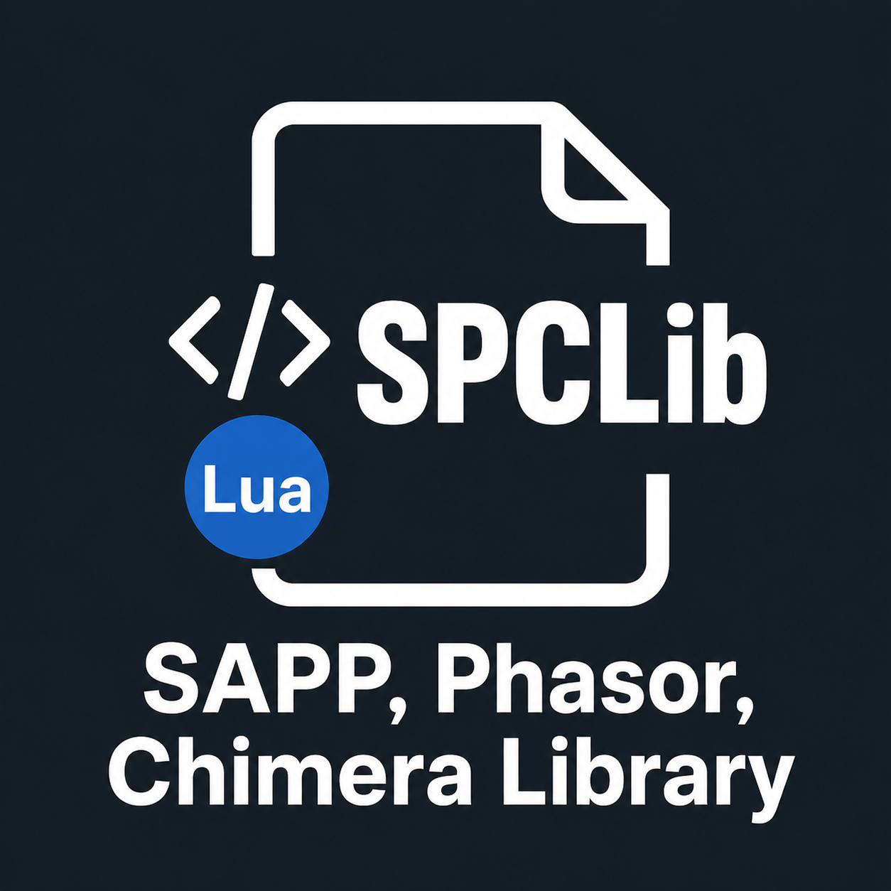

<div align="center">
  

  <br>

  <a href="mailto:chalwk.dev@gmail.com">
    
  </a>

  <a href="https://discord.gg/g6ENWebHsE">
    
  </a>

  <a href="https://chalwk.github.io/SPCLib">
    
  </a>
</div>

<br>

---

## Table of Contents <!-- omit from toc -->

- [Overview](#overview)
- [SAPP, Phasor and Chimera](#sapp-phasor-and-chimera)
    - [Platform comparison](#platform-comparison)
- [Scripts and docs](#scripts-and-docs)
    - [Script categories](#script-categories)
    - [Script boilerplate and placement](#script-boilerplate-and-placement)
- [SAPP archive and mirrors](#sapp-archive-and-mirrors)
- [Web tools](#web-tools)
    - [Script Browser](#script-browserscript_browser)
    - [Hash Checker](#hash-checkerhash_checker)
    - [HaloDiscordBot](#halodiscordbothalo_discord_bot)
- [Halo CE installer](#halo-ce-installer)
    - [Installer](#installer)
    - [1.0.10 patch](#1010-patch)
    - [LAA patches](#laa-patches)
- [Community hubs](#community-hubs)
- [Clans (past and present)](#clans-past-and-present)
- [Contributing](#contributing)
    - [Submit feature request](#submit-feature-request)
    - [Report issue](#report-issue)
- [License](#license)

---

## Overview

SPCLib (SAPP, Phasor and Chimera Library) is the largest public archive of Lua scripts and
resources for the SAPP and Phasor server extensions and the Chimera client-side mod for retail
Halo: Combat Evolved (PC) and Halo: Custom Edition (CE). Lua scripts are written and curated by
Chalwk unless noted otherwise. Scripts, guides and reference material all live here.

---

## SAPP, Phasor and Chimera

**SAPP** and **Phasor** are server-side extensions for `haloded.exe` and `haloceded.exe`. They add
scripting, anticheat, event hooks, command handling and player management to dedicated servers.

**SAPP** was developed by sehe and is the most feature-rich extension. It provides Lua scripting,
anticheat, event hooks, command handling, player management and logging.

**Phasor** is an earlier extension with similar goals.

Neither is actively maintained, but both are stable in their final released versions.

**Chimera** is a client-side mod for Halo CE, PC and Trial that exposes a Lua API. It provides event
hooks, commands, built-in map downloads and many quality-of-life fixes. Chimera scripts are fully
supported in SPCLib.

### Platform comparison

How the three environments differ. See the linked guides for detail.

| Aspect                     | SAPP                                                                          | Phasor                                                                        | Chimera                                                      |
|----------------------------|-------------------------------------------------------------------------------|-------------------------------------------------------------------------------|--------------------------------------------------------------|
| Side                       | Server                                                                        | Server                                                                        | Client                                                       |
| Lua runtime                | LuaJIT (Lua 5.1)                                                              | Lua 5.2                                                                       | Lua 5.5                                                      |
| Required boilerplate       | `api_version = "1.12.0.0"` plus `OnScriptLoad()`                              | `GetRequiredVersion()` returning `200` plus `OnScriptLoad()`                  | `clua_version = 2.056` plus `set_callback(...)`              |
| Player index               | API 1-16, memory 0-15. Convert with `to_real_index()` and `to_player_index()` | Memory 0-15, RCON 1-16. Convert with `resolveplayer()` and `rresolveplayer()` | 0-15 everywhere                                              |
| Signature scanning         | `sig_scan`                                                                    | Not available                                                                 | Not available                                                |
| Platform detection         | `halo_type` global (`"PC"` or `"CE"`)                                         | `game` arg of `OnScriptLoad`                                                  | Probe hardcoded PC/CE candidates                             |
| Run console command        | `execute_command(cmd)`                                                        | `svcmd(cmd)`                                                                  | `execute_script(cmd)`                                        |
| Memory writes              | Any address, unsafe ops crash the server                                      | Any address, unsafe ops crash the server                                      | Local player only, writing to others desyncs                 |
| Sandbox                    | None                                                                          | None                                                                          | Map scripts sandboxed, global scripts not                    |
| Script location            | `cg/sapp/lua/`, loaded from `cg/sapp/init.txt`                                | `cg/scripts/` or `cg/scripts/persistent/`                                     | `chimera/lua/scripts/global/` or `chimera/lua/scripts/maps/` |
| Reload command             | `lua_unload` then `lua_load`                                                  | `sv_script_reload [script]`                                                   | `chimera_lua_scripts_reload` (open console with `~`)         |
| Inter-script communication | Custom variables only                                                         | No built-in mechanism                                                         | Global Lua variables                                         |

---

## Scripts and docs

> [!NOTE]
> Pick the category that matches your setup: SAPP or Phasor for server-side scripting, Chimera for
> client-side scripting.

### Script categories

SAPP and Phasor Lua scripts are grouped by folder:

- `admin`: moderation and enforcement (bans, kicks, anticheat, rule enforcement)
- `chat`: chat formatting, messages and command handling
- `gameplay`: mechanics, modifiers and fun items
- `gametypes`: custom game modes and gametype variations
- `modules`: library modules used by other scripts
- `notifications`: console output, timers and event alerts
- `utility`: server configuration, spawning, map control and misc tools

| Platform             | Resource                                             | Description                                                                                     |
|----------------------|------------------------------------------------------|-------------------------------------------------------------------------------------------------|
| Scripts and releases | [SAPP Scripts][sapp_scripts]                         | Server-side Lua scripts                                                                         |
|                      | [Phasor Scripts][phasor_scripts]                     | Server-side Lua scripts                                                                         |
|                      | [Chimera Scripts][chimera_scripts]                   | Client-side Lua scripts                                                                         |
|                      | [Script Packages][releases]                          | Bundled projects with multiple files and resources, available as downloadable ZIP packages.     |
| SAPP (10.2.1)        | [Lua Scripting][sapp_scripting]                      | Server-side Lua API: signature scanning, globals and core functions.                            |
|                      | [Server Guide][sapp_server_guide]                    | Pre-configured package walkthrough covering file structure, launch and multi-server expansion.  |
|                      | [Cheat Sheet][sapp_cheat_sheet]                      | Pointers, signatures, variables and commands for SAPP server scripting.                         |
|                      | [Utils][sapp_utils]                                  | Conventions, helper functions and known quirks for SAPP Lua scripting.                          |
|                      | [Lua Script Template][sapp_lua_template]             | Script skeleton and callback reference for SAPP.                                                |
| Phasor V2 (2.0)      | [Lua Scripting][scripting_with_phasor]               | Server-side Lua scripting with version handling and hardcoded addresses.                        |
|                      | [Server Guide][phasor_server_guide]                  | Pre-configured package walkthrough covering file structure and launch.                          |
|                      | [Lua Script Template][phasor_lua_template]           | Script skeleton and callback reference for Phasor.                                              |
| Chimera              | [Lua Scripting][chimera_scripting]                   | Client-side Lua scripting with event callbacks, script placement and version compatibility.     |
|                      | [Lua Script Template][chimera_lua_template]          | Script skeleton and callback reference for Chimera.                                             |
| Shared references    | [Lua References][lua_common_ref]                     | Shared memory offsets, game constants and helpers for SAPP and Chimera.                         |
|                      | [Modding Tools][modding_refs]                        | Tag editing, map rebuilding, asset injection and community tooling references.                  |
|                      | [VPS Hosting (Ubuntu 22.04)][vps_host_guide]         | Full setup with Wine, VNC, firewall, SSH and fail2ban.                                          |
|                      | [Port Forwarding][port_forwarding]                   | Router config for UDP port 2302 and the server port, plus firewall rules for Windows and Linux. |

### Script boilerplate and placement

Every platform refuses to load a script that is missing its required declaration. The minimal
skeleton and correct file location for each platform is below. See the matching guide for the full
template and every available callback.

**SAPP**: put the file in `cg/sapp/lua/<script>.lua`. Load it from `cg/sapp/init.txt` with
`lua_load "<script>"`. The extension is omitted and lua true must be set first.

```lua
api_version = "1.12.0.0"

function OnScriptLoad()
    register_callback(cb.EVENT_JOIN, "OnJoin")
end

function OnJoin(player_id)
    say(player_id, "Hello, World!")
end

function OnScriptUnload() end
```

Do signature `scans` and `get_var` lookups inside `OnScriptLoad()` or a callback, never at file
scope.

**Phasor**: put the file in `cg/scripts/<script>.lua`, or `cg/scripts/persistent/` to survive map
changes. Load with `sv_script_load "<script>"`.

```lua
function GetRequiredVersion() return 200 end

  -- Set up pointers and state here. game is "PC" or "CE".
function OnScriptLoad(process_id, game, persistent)
    
end

function OnScriptUnload() end
```

**Chimera**: put the file in `chimera/lua/scripts/global/<script>.lua` (unsandboxed) or
`chimera/lua/scripts/maps/<map>.lua` (sandboxed). Reload any time with `chimera_lua_scripts_reload`
in the console with `~`.

```lua
clua_version = 2.056

set_callback("map load", "OnMapLoad")
set_callback("tick",     "OnTick")

function OnMapLoad()
    console_out("Map: (" .. map .. ")")
end

function OnTick() end
```

> [!IMPORTANT]
> **SAPP** scripts cannot call each other directly. Custom variables (`add_var`, `set_var`,
`get_var`) are the only shared channel. **Phasor** has no built-in mechanism. **Chimera** scripts
share the global Lua environment and can use global variables.

> [!TIP]
> **Chimera** map scripts are sandboxed by default. `io.*`, `dofile`, `load`, `require`,
`os.execute` and memory writes outside `0x40000000` to `0x41B00000` are blocked. Put a script in the
global folder if it needs file access or unrestricted memory writes.

---

## SAPP archive and mirrors

<details>
<summary>Archival SAPP binaries and documentation (click to expand)</summary>

The official SAPP site (halo.isimaginary.com) is gone. To keep historical versions reachable, this
repo mirrors every released [SAPP binary][sapp_downloads_dir].

It also preserves:

- SAPP Documentation Revision 2.4 and 2.5 (by 002 / SnowyMouse)
- Memory offsets reference list originally created by Wizard

These documents and binaries are redistributed for preservation only. Licensing stays with the
original authors.

</details>

---

## Web tools

### [Script Browser][script_browser]

Live search and filtering for every script in SPCLib.

### [Hash Checker][hash_checker]

Identifies known cracked hashes. Banning or granting admin to a hash without checking first can
affect innocent players sharing the same cracked key.

### [HaloDiscordBot][halo_discord_bot]

JDK integration that pipes Halo server events into Discord as rich embeds.

---

## Halo CE installer

> [!NOTE]
> You must own a valid CD key to install Halo Custom Edition.

### Installer

- [halo_ce_installer.zip][halo_ce_installer]

### 1.0.10 patch

- [haloce-patch-1.0.10.zip][haloce_patch]

### LAA patches

> [!NOTE]
> Large Address Aware (LAA) patches let Halo use more than 2 GB of RAM on 64-bit systems.

[Download page][laa_patched]

---

## Community hubs

<details>
<summary>Active and legacy Halo PC/CE communities (click to expand)</summary>

Activity varies across hubs. Some are active, others are legacy archives.

| Hub                                                                          | Description                                                                                    |
|------------------------------------------------------------------------------|------------------------------------------------------------------------------------------------|
| Chalwk - Code & Chill, [Discord][chalwk_discord]                             | Community server for all my projects, support and general chat.                                |
| Open Carnage, [Website][opencarnage_website], [Discord][opencarnage_discord] | Former major CE modding forum, now read-only after DDoS attacks.                               |
| Chimera, [Forum][chimera_forum], [Discord][chimera_discord]                  | Essential client-side mod with map downloads, renderer fixes and quality-of-life improvements. |
| Halo Net, [Website][halonet_website]                                         | HAC2 map repo and update server, auto-downloads thousands of custom maps.                      |
| XG Gaming, [Website][xg_website] (archived)                                  | Former clan community (servers, forums, downloads). Domain now offline.                        |
| POQ Clan, [Website][poq_website]                                             | One of the oldest Halo PC/CE clans (2006) with 19 public servers and custom mods.              |
| BK (BlacksHalo), [Website][bk_website]                                       | Well-known clan running popular servers for 15+ years.                                         |
| Liberty, [Discord][liberty_discord]                                          | Active CE community (founded 2024) hosting CTF, Slayer, Oddball and Racing servers.            |
| Reclaimers, [Website][reclaimers_website], [Discord][reclaimers_discord]     | Community wiki and resource hub for Halo CE and MCC modding tools.                             |
| Realworld CE, [Website][realworld_website]                                   | Guild and custom map blog offering hundreds of exclusive multiplayer maps.                     |

</details>

---

## Clans (past and present)

<details>
<summary>Halo PC/CE clans across the years (click to expand)</summary>

Historical and current Halo PC/CE clans and communities over the years.

```
\- YAS -, -db-, «§», «Ag~, «Ð²Ä», «MAD», [Aķ], [CV], [GTV], [HGE], [IG], [IS], [K2], [McK], [Nbk], [VR], [WFFF], ]
ZTA[. VSA, {ATP}, {BK}, {CK}, {CRG}, {HWS}, {LoH}, {NR}, {OTH}, {ØZ}, {PWH}, {SK}, {SSC}, {V3}, {X}, {XF} = SL =,
{XG}, = EP =, = NcS =, = XA=, =DN=, =RDA=, £V», ÄÄÄ, AOD, AR, BR, BZ, C#w, CAF, CB, CES, CGD, CHr, CK, ÇM, CODE, CSI,
CST, DFS, DR, Ðu¥, EK, ev, FCM, Fem1, Fez`, FIG, FooK, GDS, GoD, GRO, HH, HSF, HTK3, IR, KB, KMT, KoD, KoF, LaG, LF,
LIB, LNZ, LP, LTD2, M5, MR, MVL, ňc, ÑE», ñuß, OSR, OWV, P§ycho, PÕQ, PRO, RC, RSF, SAR, SB, SDR, ßE, TBR, TCS, TFT,
TM, ToR, X¬, xOSHx, xT
```

</details>

---

## Contributing

Bug reports and feature requests go through GitHub issues and discussion templates. See the
[Contributing Guide](CONTRIBUTING.md). All community interaction is governed by the
[Code of Conduct](CODE_OF_CONDUCT.md). To report a security problem, see [SECURITY.md](SECURITY.md).

### Submit feature request

[Submit feature request][feature_request]

### Report issue

- [Bug report][bug_report]
- [Feature request][feature_request]

---

## License

> [!CAUTION]
> Halo is a trademark of Microsoft. This project is not affiliated with or endorsed by Microsoft or
> its subsidiaries, including Halo Studios (formerly 343 Industries).

[SPCLib][repo_url] is licensed under the [MIT License](LICENSE).

---

[bk_website]: https://www.blackshalo.com
[bug_report]: https://github.com/Chalwk/SPCLib/issues/new?assignees=Chalwk&labels=Bug%2CNeeds+Triage&template=BUG_REPORT.yaml
[chalwk_discord]: https://discord.gg/g6ENWebHsE
[chimera_discord]: https://discord.gg/ZwQeBE2
[chimera_forum]: https://opencarnage.net/index.php?/topic/6916-chimera-download-source-code-and-discord/
[chimera_lua_template]: https://chalwk.github.io/halo/chimera/template/
[chimera_scripting]: https://chalwk.github.io/halo/chimera/scripting-with-chimera/
[chimera_scripts]: chimera
[chimera]: https://github.com/SnowyMouse/chimera
[feature_request]: https://github.com/Chalwk/SPCLib/issues/new?template=FEATURE_REQUEST.yaml
[halo_ce_installer]: https://drive.google.com/file/d/1oO0w_25mGwjTz_R9Bhquah4FR6u2Ccmz/view?usp=sharing
[halo_discord_bot]: https://github.com/Chalwk/HaloDiscordBot
[haloce_patch]: https://drive.google.com/file/d/1hVSFN24JPlfR7cC2eoFrbLA7NGcRZo7a/view?usp=sharing
[halonet_website]: https://halonet.net/
[hash_checker]: https://chalwk.github.io/SPCLib/tools/hash-checker
[laa_patched]: https://github.com/Chalwk/SPCLib/releases/tag/laa_patched
[liberty_discord]: https://discord.gg/3J2Zppghz5
[lua_common_ref]: https://chalwk.github.io/halo/common-reference/
[modding_refs]: https://chalwk.github.io/halo/modding-references/
[opencarnage_discord]: https://discord.gg/2pf3Yjb
[opencarnage_website]: https://opencarnage.net
[paypal_donate]: https://www.paypal.com/ncp/payment/XUPTKDU6LKM3G
[phasor_scripts]: phasor
[phasor_lua_template]: https://chalwk.github.io/halo/phasor/template/
[phasor_server_template]: https://github.com/Chalwk/SPCLib/releases/tag/phasor-server-templates
[poq_website]: http://poqclan.com/
[port_forwarding]: https://chalwk.github.io/halo/server-port-forwarding/
[realworld_website]: https://www.realworldce.com/
[reclaimers_discord]: https://discord.reclaimers.net/
[reclaimers_website]: https://c20.reclaimers.net/
[releases]: https://github.com/Chalwk/SPCLib/releases
[repo_url]: https://github.com/Chalwk/SPCLib
[sapp_cheat_sheet]: https://chalwk.github.io/halo/sapp/cheat-sheet/
[sapp_command_ref]: https://chalwk.github.io/blog/2026/05/17/halo-sapp-command-reference/
[sapp_downloads_dir]: assets/sapp_downloads
[sapp_lua_template]: https://chalwk.github.io/halo/sapp/template/
[sapp_scripting]: https://chalwk.github.io/halo/sapp/scripting-with-sapp/
[sapp_scripts]: sapp
[sapp_server_guide]: https://chalwk.github.io/halo/sapp/server-guide/
[sapp_server_template]: https://github.com/Chalwk/SPCLib/releases/tag/sapp-server-templates
[phasor_server_guide]: https://chalwk.github.io/halo/phasor/server-guide/
[sapp_utils]: https://chalwk.github.io/halo/sapp/utils/
[script_browser]: https://chalwk.github.io/SPCLib/tools/script-browser
[scripting_with_phasor]: https://chalwk.github.io/halo/phasor/scripting-with-phasor/
[vps_host_guide]: https://chalwk.github.io/halo/ubuntu-vps-hosting/
[xg_website]: https://www.xgclan.com