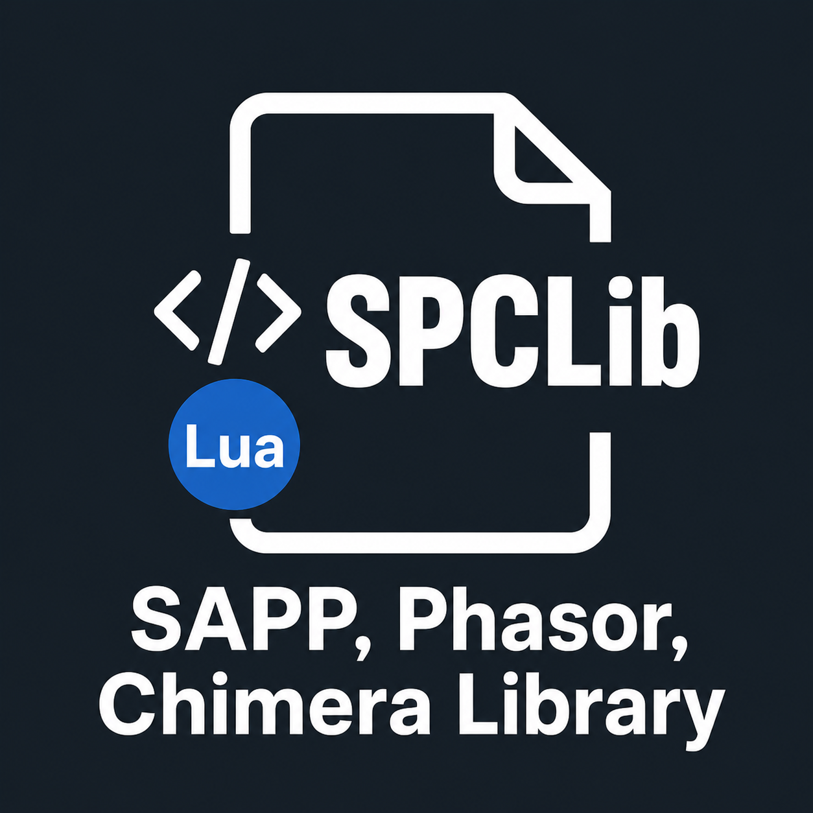

<div align="center">
  

  <br>

  <a href="mailto:chalwk.dev@gmail.com">
    
  </a>

  <a href="https://discord.gg/g6ENWebHsE">
    
  </a>

  <a href="https://chalwk.github.io/SPCLib">
    
  </a>
</div>

<br>

---

## Table of Contents <!-- omit from toc -->

- [Overview](#overview)
- [SAPP, Phasor and Chimera](#sapp-phasor-and-chimera)
- [Scripts and docs](#scripts-and-docs)
  - [Script categories](#script-categories)
  - [Scripts and releases](#scripts-and-releases)
  - [Guides and references](#guides-and-references)
  - [Script placement](#script-placement)
- [SAPP archive and mirrors](#sapp-archive-and-mirrors)
- [Web tools](#web-tools)
  - [Script Browser](#script-browser)
  - [Hash Checker](#hash-checker)
  - [HaloDiscordBot](#halodiscordbot)
- [Halo CE installer](#halo-ce-installer)
  - [Installer](#installer)
  - [1.0.10 patch](#1010-patch)
  - [LAA patches](#laa-patches)
- [Community hubs](#community-hubs)
- [Clans (past and present)](#clans-past-and-present)
- [Contributing](#contributing)
- [License](#license)

---

## Overview

SPCLib (SAPP, Phasor and Chimera Library) is the largest public archive of Lua scripts and
resources for the SAPP and Phasor server extensions and the Chimera client-side mod for retail
Halo: Combat Evolved (PC) and Halo: Custom Edition (CE). Lua scripts are written and curated by
Chalwk unless noted otherwise. Scripts live in this repo. The guides and reference material are
hosted on [chalwk.github.io][chalwk_website].

---

## SAPP, Phasor and Chimera

**SAPP** and **Phasor** are server-side extensions for `haloded.exe` and `haloceded.exe`. They add
scripting, anticheat, event hooks, command handling and player management to dedicated servers.
SAPP was developed by sehe and is the more feature-rich of the two. Neither is actively
maintained, but both are stable in their final released versions.

**Chimera** is a client-side mod for Halo PC, CE and Trial. It provides event hooks, commands,
built-in map downloads and many quality-of-life fixes, and it has its own Lua API.

Which one do you need? If you host a server, use SAPP or Phasor. If you only play and want
client-side tweaks, use Chimera.

| Platform | Runs on | Lua runtime      | Script entry point                                   |
| -------- | ------- | ---------------- | ---------------------------------------------------- |
| SAPP     | Server  | LuaJIT (Lua 5.1) | `api_version`, `OnScriptLoad()`, `register_callback` |
| Phasor   | Server  | Lua 5.2          | `GetRequiredVersion()`, `OnScriptLoad()`             |
| Chimera  | Client  | Lua 5.5.1        | `clua_version`, `set_callback`                       |

The API sections of each guide double as EmmyLua / LuaLS definitions, so you can paste them into
VS Code for completion and type hints.

---

## Scripts and docs

### Script categories

SAPP and Phasor Lua scripts are grouped by folder:

- `admin`: moderation and enforcement (bans, kicks, anticheat, rule enforcement)
- `chat`: chat formatting, messages and command handling
- `gameplay`: mechanics, modifiers and fun items
- `gametypes`: custom game modes and gametype variations
- `modules`: library modules used by other scripts
- `notifications`: console output, timers and event alerts
- `utility`: server configuration, spawning, map control and misc tools

### Scripts and releases

| Platform         | Resource                           | Description                                                                                 |
| ---------------- | ---------------------------------- | ------------------------------------------------------------------------------------------- |
| SAPP             | [SAPP Scripts][sapp_scripts]       | Server-side Lua scripts                                                                     |
| Phasor           | [Phasor Scripts][phasor_scripts]   | Server-side Lua scripts                                                                     |
| Chimera          | [Chimera Scripts][chimera_scripts] | Client-side Lua scripts                                                                     |
| Shared libraries | [Lua Libraries][lua_libraries]     | Cross-compatible Lua code and data libraries for SAPP, Phasor, and Chimera                  |
| Bundled projects | [Script Packages][releases]        | Bundled projects with multiple files and resources, available as downloadable ZIP packages. |

### Guides and references

| Platform          | Resource                                                                      | Description                                                                                                                                                           |
| ----------------- | ----------------------------------------------------------------------------- | --------------------------------------------------------------------------------------------------------------------------------------------------------------------- |
| SAPP (10.2.1)     | [SAPP Server and Lua API Guide][sapp_guide]                                   | Complete guide to setting up, configuring, and running SAPP dedicated servers and writing server-side Lua scripts.                                                    |
| Phasor V2 (2.0)   | [Phasor Server and Lua API Guide][phasor_guide]                               | Complete guide to setting up, configuring, and running Phasor dedicated servers and writing server-side Lua scripts.                                                  |
| Chimera           | [Scripting with Chimera (Client-Side Lua)][chimera_guide]                     | Complete guide to client-side Lua scripting with Chimera.                                                                                                             |
| Shared references | [Shared reference for SAPP, Phasor and Chimera Lua scripting][lua_common_ref] | Shared reference for SAPP, Phasor and Chimera Lua scripting: memory offsets, game constants, platform-independent helpers, and stock Halo commands.                   |
|                   | [Modding Tools][modding_refs]                                                 | References and tools for Halo PC and Custom Edition modding, from the classic HEK to modern toolchains and asset pipelines.                                           |
|                   | [VPS Hosting (Ubuntu 22.04)][vps_host_guide]                                  | Step-by-step guide to hosting a secure Halo PC / Custom Edition dedicated server (SAPP or Phasor) on a Vultr Ubuntu 22.04 VPS using Wine, TightVNC, UFW and fail2ban. |
|                   | [Port Forwarding][port_forwarding]                                            | Complete guide to router port forwarding and firewall setup for hosting Halo PC and Custom Edition dedicated servers.                                                 |

### Script placement

Paths below start from your instance folder, which is `cg` in the server packages. Some hosting
providers (NFO, for example) have no `cg` folder, so use the server root instead.

- **SAPP**
  - **Script placement:** `<instance or server root>\sapp\lua\<script>.lua`
  - **Load / reload:** Open `<instance or server root>\sapp\init.txt`, set `lua true`, then add
    `lua_load "<script>"` (no `.lua` extension). You can also run `lua_load <script>` and
    `lua_unload <script>` to load/unload scirpts.

- **Phasor**
  - **Script placement:**
    - `<instance or server root>\scripts\<script>.lua`, unloaded at the end of each game
    - or `<instance or server root>\scripts\persistent\` to stay loaded across maps
  - **Load / reload:** `sv_script_load <script>` (no `.lua` extension), or list the script at the
    end of an `sv_mapcycle_add` line in the startup `init.txt` to load it for that map only.

- **Chimera**
  - **Script placement:**
    - `chimera\lua\scripts\global\<script>.lua`, loads on start and stays active
    - or `chimera\lua\scripts\map\<map>.lua`, loads only while that map is active
  - **Chimera folder:**
    - Windows, CE: `%USERPROFILE%\Documents\My Games\Halo CE\chimera`
    - Windows, PC: `%USERPROFILE%\Documents\My Games\Halo\chimera`
    - Linux: `~/Documents/My Games/Halo CE/chimera` or `~/Documents/My Games/Halo/chimera`,
      depending on your setup
  - **Reload:** `chimera_lua_scripts_reload` in the console, opened with `~`

---

## SAPP archive and mirrors

<details>
<summary>Archival SAPP binaries and documentation (click to expand)</summary>

The official SAPP site (halo.isimaginary.com) is gone. To keep historical versions reachable, this
repo mirrors every released [SAPP binary][sapp_downloads_dir].

It also preserves:

- SAPP Documentation Revision 2.4 and 2.5 (by 002 / SnowyMouse)
- Memory offsets reference list originally created by Wizard

These documents and binaries are redistributed for preservation only. Licensing stays with the
original authors.

</details>

---

## Web tools

### [Script Browser][script_browser]

Live search and filtering for every script in SPCLib.

### [Hash Checker][hash_checker]

Identifies known cracked hashes. Banning or granting admin to a hash without checking first can
affect innocent players sharing the same cracked key.

### [HaloDiscordBot][halo_discord_bot]

Java Discord bot that pipes Halo server events into Discord as rich embeds.

---

## Halo CE installer

> [!NOTE]
> You must own a valid CD key to install Halo Custom Edition.

### Installer

- [halo_ce_installer.zip][halo_ce_installer]

### 1.0.10 patch

- [haloce-patch-1.0.10.zip][haloce_patch]

### LAA patches

> [!NOTE]
> Large Address Aware (LAA) patches let Halo use more than 2 GB of RAM on 64-bit systems.

[Download page][laa_patched]

---

## Community hubs

<details>
<summary>Active and legacy Halo PC/CE communities (click to expand)</summary>

Activity varies across hubs. Some are active, others are legacy archives.

| Hub                                                                          | Description                                                                                    |
| ---------------------------------------------------------------------------- | ---------------------------------------------------------------------------------------------- |
| Chalwk - Code & Chill, [Discord][chalwk_discord]                             | Community server for all my projects, support and general chat.                                |
| Open Carnage, [Website][opencarnage_website], [Discord][opencarnage_discord] | Former major CE modding forum, now read-only after DDoS attacks.                               |
| Chimera, [Forum][chimera_forum], [Discord][chimera_discord]                  | Essential client-side mod with map downloads, renderer fixes and quality-of-life improvements. |
| Halo Net, [Website][halonet_website]                                         | HAC2 map repo and update server, auto-downloads thousands of custom maps.                      |
| XG Gaming, [Website][xg_website] (archived)                                  | Former clan community (servers, forums, downloads). Domain now offline.                        |
| POQ Clan, [Website][poq_website]                                             | One of the oldest Halo PC/CE clans (2006) with 19 public servers and custom mods.              |
| BK (BlacksHalo), [Website][bk_website]                                       | Well-known clan running popular servers for 15+ years.                                         |
| Liberty, [Discord][liberty_discord]                                          | Active CE community (founded 2024) hosting CTF, Slayer, Oddball and Racing servers.            |
| Reclaimers, [Website][reclaimers_website], [Discord][reclaimers_discord]     | Community wiki and resource hub for Halo CE and MCC modding tools.                             |
| Realworld CE, [Website][realworld_website]                                   | Guild and custom map blog offering hundreds of exclusive multiplayer maps.                     |

</details>

---

## Clans (past and present)

<details>
<summary>Halo PC/CE clans across the years (click to expand)</summary>

Historical and current Halo PC/CE clans and communities over the years.

```
\- YAS -, -db-, «§», «Ag~, «Ð²Ä», «MAD», [Aķ], [CV], [GTV], [HGE], [IG], [IS], [K2], [McK], [Nbk], [VR], [WFFF], ]
ZTA[. VSA, {ATP}, {BK}, {CK}, {CRG}, {HWS}, {LoH}, {NR}, {OTH}, {ØZ}, {PWH}, {SK}, {SSC}, {V3}, {X}, {XF} = SL =,
{XG}, = EP =, = NcS =, = XA=, =DN=, =RDA=, £V», ÄÄÄ, AOD, AR, BR, BZ, C#w, CAF, CB, CES, CGD, CHr, CK, ÇM, CODE, CSI,
CST, DFS, DR, Ðu¥, EK, ev, FCM, Fem1, Fez`, FIG, FooK, GDS, GoD, GRO, HH, HSF, HTK3, IR, KB, KMT, KoD, KoF, LaG, LF,
LIB, LNZ, LP, LTD2, M5, MR, MVL, ňc, ÑE», ñuß, OSR, OWV, P§ycho, PÕQ, PRO, RC, RSF, SAR, SB, SDR, ßE, TBR, TCS, TFT,
TM, ToR, X¬, xOSHx, xT
```

</details>

---

## Contributing

Bug reports and feature requests go through GitHub issues. See the
[Contributing Guide](CONTRIBUTING.md). All community interaction is governed by the
[Code of Conduct](CODE_OF_CONDUCT.md). To report a security problem, see [SECURITY.md](SECURITY.md).

- [Report a bug][bug_report]
- [Request a feature][feature_request]

---

## License

> [!CAUTION]
> Halo is a trademark of Microsoft. This project is not affiliated with or endorsed by Microsoft or
> its subsidiaries, including Halo Studios (formerly 343 Industries).

[SPCLib][repo_url] is licensed under the [MIT License](LICENSE).

---

[bk_website]: https://www.blackshalo.com
[bug_report]: https://github.com/Chalwk/SPCLib/issues/new?assignees=Chalwk&labels=Bug%2CNeeds+Triage&template=BUG_REPORT.yaml
[chalwk_discord]: https://discord.gg/g6ENWebHsE
[chimera_discord]: https://discord.gg/ZwQeBE2
[chalwk_website]: https://chalwk.github.io/
[chimera_forum]: https://opencarnage.net/index.php?/topic/6916-chimera-download-source-code-and-discord/
[chimera_guide]: https://chalwk.github.io/halo/chimera/guide/
[chimera_scripts]: chimera
[feature_request]: https://github.com/Chalwk/SPCLib/issues/new?template=FEATURE_REQUEST.yaml
[halo_ce_installer]: https://drive.google.com/file/d/1oO0w_25mGwjTz_R9Bhquah4FR6u2Ccmz/view?usp=sharing
[halo_discord_bot]: https://github.com/Chalwk/HaloDiscordBot
[haloce_patch]: https://drive.google.com/file/d/1hVSFN24JPlfR7cC2eoFrbLA7NGcRZo7a/view?usp=sharing
[halonet_website]: https://halonet.net/
[hash_checker]: https://chalwk.github.io/SPCLib/tools/hash-checker
[laa_patched]: https://github.com/Chalwk/SPCLib/releases/tag/laa_patched
[liberty_discord]: https://discord.gg/3J2Zppghz5
[lua_common_ref]: https://chalwk.github.io/halo/common-reference/
[lua_libraries]: libraries
[modding_refs]: https://chalwk.github.io/halo/modding-references/
[opencarnage_discord]: https://discord.gg/2pf3Yjb
[opencarnage_website]: https://opencarnage.net
[phasor_guide]: https://chalwk.github.io/halo/phasor/guide/
[phasor_scripts]: phasor
[poq_website]: http://poqclan.com/
[port_forwarding]: https://chalwk.github.io/halo/server-port-forwarding/
[realworld_website]: https://www.realworldce.com/
[reclaimers_discord]: https://discord.reclaimers.net/
[reclaimers_website]: https://c20.reclaimers.net/
[releases]: https://github.com/Chalwk/SPCLib/releases
[repo_url]: https://github.com/Chalwk/SPCLib
[sapp_downloads_dir]: assets/sapp_downloads
[sapp_guide]: https://chalwk.github.io/halo/sapp/guide/
[sapp_scripts]: sapp
[script_browser]: https://chalwk.github.io/SPCLib/tools/script-browser
[vps_host_guide]: https://chalwk.github.io/halo/ubuntu-vps-hosting/
[xg_website]: https://www.xgclan.com
